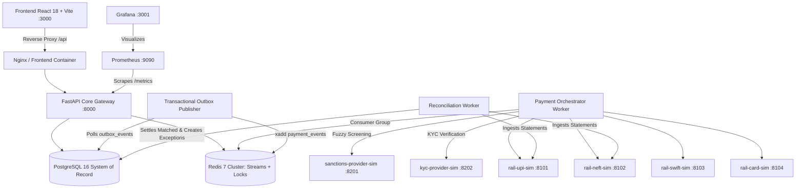

# PayNexus: Payments Modernisation Platform

[](https://github.com/paynexus/paynexus)
[](https://fastapi.tiangolo.com)
[](https://react.dev)
[](https://docker.com)
[](LICENSE)

> A production-grade, multi-rail payments modernisation platform engineered with canonical ISO 20022 messaging, bulletproof dual-layer idempotency, an integrated compliance pipeline (KYC, sanctions, fraud rules & ML anomaly detection), double-entry ledger settlement, automated two-tier statement reconciliation, and cryptographic SHA-256 audit trails.

---

## 1. System Architecture



---

## 2. Quick Start (< 5 Minutes)

### Prerequisites
- Docker Engine 24+ & Docker Compose v2.20+
- Git

### Option A: Local Python & Node Startup (Zero Docker Required)
```bash
# 1. Backend Setup & Seed
cd backend
python -m pip install -r requirements.txt
python -m pip install aiosqlite fakeredis greenlet email-validator faker sse-starlette python-jose argon2-cffi
python scripts/seed.py
uvicorn app.main:app --port 8000 --host 127.0.0.1 --reload

# 2. Frontend Setup (in a separate terminal)
cd ../frontend
npm install
npm run dev -- --port 3000
```

### Option B: Docker Compose Startup
```bash
# Clone and start all services, mock rails, and databases
docker compose up --build -d
```

### Access URLs
- **Web UI**: [http://localhost:3000](http://localhost:3000)
- **FastAPI Interactive OpenAPI Docs**: [http://localhost:8000/docs](http://localhost:8000/docs)
- **Liveness Probe**: [http://localhost:8000/healthz](http://localhost:8000/healthz)
- **Prometheus Metrics**: [http://localhost:8000/metrics](http://localhost:8000/metrics)

---

## 3. Demo Credentials

| Role | Email | Password | Permissions |
|---|---|---|---|
| **ADMIN** | `admin@paynexus.io` | `Demo@PayNexus2026!` | Full platform administration, system settings, tamper injection |
| **OPERATIONS** | `ops@paynexus.io` | `Demo@PayNexus2026!` | Payments management, reconciliation runs, exception resolution, DLQ replay |
| **COMPLIANCE_OFFICER**| `compliance@paynexus.io` | `Demo@PayNexus2026!` | Sanctions screening queue, four-eyes maker-checker approval, fraud rules |
| **AUDITOR** | `auditor@paynexus.io` | `Demo@PayNexus2026!` | Read-only access, cryptographic audit hash-chain verification |
| **MERCHANT** | `merchant@paynexus.io` | `Demo@PayNexus2026!` | Submit payments, view transaction timelines and webhook logs |

*Tip: The web UI login screen features quick-fill chips for one-click authentication as any role.*

---

## 4. Step-by-Step Demo Script (5 Minutes)

### Scenario 1: Happy Path Settlement & Real-Time Stream
1. Open [http://localhost:3000](http://localhost:3000) and log in as `admin@paynexus.io`.
2. Navigate to **New Payment** (`/payments/new`).
3. Select an account, input `1500.00` INR, select `INSTANT` urgency. Notice the **Smart Rail Recommendation** panel recommending UPI as the cheapest and fastest option.
4. Click **Submit Payment**.
5. Switch to the **Executive Dashboard** (`/`) to observe live KPI increments and the transaction streaming in real-time.

### Scenario 2: Bulletproof Idempotency Verification
1. On the **New Payment** page, without refreshing, click **Resend (Duplicate Test)**.
2. The server returns the cached response with header `Idempotent-Replayed: true`.
3. Open the **Payments** table (`/payments`) to confirm that exactly **one** payment was created. Zero duplicate charges.

### Scenario 3: Sanctions Screening & Four-Eyes Approval
1. Go to **New Payment** and enter description `Payment for Viktor Bout`.
2. Submit the payment. The compliance pipeline triggers a RapidFuzz match against the OFAC watchlist and moves the payment to `REVIEW`.
3. Switch to **Compliance Centre** (`/compliance`). The item appears in the screening queue.
4. Click **Review & Decide**. As a secondary officer, state a reason and click **Approve & Release**. The payment transitions to `AUTHORISED` and dispatches to the rail.

### Scenario 4: Chaos Engineering Lab & Circuit Breaker Failover
1. Go to **Rails & Chaos Lab** (`/rails`).
2. Select `UPI` and toggle **Rail In Outage Mode** or set **Error Rate** to 100%. Click **Apply Chaos**.
3. Submit a new payment. The circuit breaker trips to `OPEN`.
4. Observe the circuit breaker badge change to `OPEN` in real-time. Click **Reset Breaker** to restore normal operation.

### Scenario 5: Automated Reconciliation & Exception Drill-Down
1. Navigate to **Reconciliation** (`/reconciliation`).
2. Click **Upload Statement** and upload a bank statement CSV or camt.053 XML file.
3. Observe the automated 2-tier matching pipeline: matched items are confirmed settled; unmatched records are classified into `AMOUNT_MISMATCH`, `MISSING_AT_RAIL`, etc.
4. Click **Force Settle** or **Dismiss** on an exception to execute one-click resolution.

### Scenario 6: Cryptographic Audit Hash-Chain & Tamper Detection
1. Navigate to **Audit Explorer** (`/audit`).
2. Click **Verify Chain Integrity**. A green banner verifies all sequential records match their forward SHA-256 hash links.
3. Click **Tamper Demo**. This deliberately mutates a database row.
4. Re-run **Verify Chain Integrity**. An alert immediately pinpoints the exact corrupted sequence number.

### Scenario 7: Intelligent Payment Investigation Assistant (Novelty AI Feature)
1. Go to the **Executive Dashboard** (`/`).
2. In the **Payment Investigation Assistant** panel at the bottom:
   - Click the preset: **"Which simulated payment rail has the highest failure rate?"**
   - Click **Investigate**. Observe deterministic diagnostic evidence, health stats, circuit breaker states, and actionable recommendations.
   - Enter a query for any payment reference (e.g. `Why is transaction PNX-20261015-xxx in review?`).
   - The assistant performs an authoritative database lookup, extracts exact compliance findings, provides evidence, and issues intelligent retry recommendations respecting state invariants.

---

## 5. Problem Statement Requirements Mapping

| Requirement | Implementation & Component | Verification |
|---|---|---|
| **Standardised ISO 20022 APIs** | `app/services/translation_service.py` with lxml & Pydantic models for pain.001, pacs.008, pacs.002, and camt.053 | Message Translator playground (`/messages`) |
| **Bulletproof Idempotency** | Redis SETNX lock (fast-path) + PostgreSQL unique constraint on `idempotency_keys` | Concurrent load test script (`scripts/load_test.py`) |
| **Strict State Machine** | Canonical transition table in `app/domain/state_machine.py` with optimistic locking (`version` column) | State machine unit tests (`test_state_machine.py`) |
| **Integrated Compliance Pipeline** | KYC limits (`kyc_service.py`), RapidFuzz sanctions matching (`sanctions_service.py`), JSON-Logic rules & Isolation Forest anomaly ML (`fraud_service.py`) | Screening queue & four-eyes approval workflow |
| **Double-Entry Ledger** | Balanced journal entries (`ledger_service.py`) with holds, settlements, and compensating reversals | Ledger invariants tests (`test_ledger_invariants.py`) |
| **Automated Reconciliation** | Two-tier exact & fuzzy matcher with exception classification (`recon_service.py`) | Reconciliation UI & statement upload |
| **Immutable Cryptographic Audit** | DB triggers blocking UPDATE/DELETE + SHA-256 forward hash-chain (`audit_service.py`) | Verify Integrity API & Tamper Demo |
| **Zero Hardcoded Data** | All UI metrics queried live via API from DB; all thresholds in `system_settings` table | Grep verified: zero static mock data in frontend |

---

## 6. Design Decisions & Scope Limitations

### Key Design Decisions
1. **Double-Entry Ledger Invariants**: Ledger entries are append-only. When a payment is reversed or refunded, compensating inverse journal entries are created; past entries are never deleted or modified.
2. **Four-Eyes Separation of Duties**: Maker-checker strictly verifies that the user approving a transaction is distinct from the initiator who requested it.
3. **Hexagonal Rail Adapters**: Mock rail services run in independent Docker containers with configurable latency, error rates, and packet drop simulation to prove duplicate safety.
4. **Isolation Forest Anomaly Scoring**: Synthetic training occurs at startup if no model file exists, persisting to `/app/models/fraud_model.pkl` and blending into the final risk score.

### Scope Limitations
- Cryptographic key management uses Fernet environment keys rather than an enterprise Hardware Security Module (HSM).
- SWIFT MT103 mapping illustrates core fields (:20, :32A, :50K, :59, :70, :71A); full ISO 15022 validation requires certified SWIFT parser libraries.