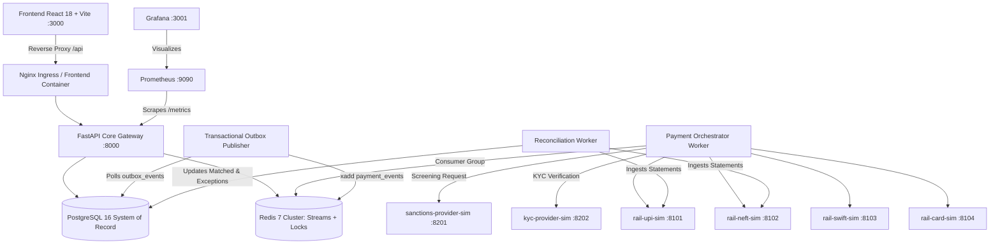
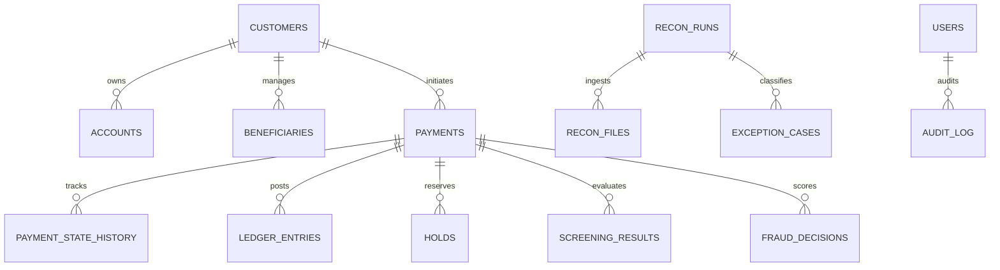

# PayNexus: Platform Architecture & System Design

## 1. Executive Summary
PayNexus is a high-throughput, multi-rail payments modernisation and orchestration engine designed to resolve the fundamental issues of legacy banking systems: incompatible message formats (SWIFT MT103 vs ISO 20022), double-charge duplicate vulnerabilities, siloed compliance screening, non-deterministic state management, and slow reconciliation breaks.

---

## 2. System Architecture & Topology

---

## 3. Core Architectural Patterns

### 3.1 Hexagonal Architecture (Ports and Adapters)
Every payment rail (UPI, NEFT, SWIFT, Card) is an isolated plug-in adapter implementing a unified Python `PaymentRailAdapter` interface. Switching rails or adding FedNow / SEPA requires implementing only one adapter without touching orchestrator core logic.

### 3.2 Transactional Outbox Pattern
State transitions and outbox events are committed inside the exact same atomic PostgreSQL database transaction:
1. `payment.state` updated to `VALIDATED`
2. `outbox_events` row inserted with payload
3. Commit transaction
4. Dedicated outbox publisher polls pending records and pushes them into Redis Stream `payment_events`.
Zero message loss even if the worker or container restarts unexpectedly.

### 3.3 Bulletproof Dual-Layer Idempotency
- **Layer 1 (Fast-Path Lock)**: Redis `SETNX idempotency:{key}` with 30-second TTL to serialize concurrent parallel requests.
- **Layer 2 (Final Arbiter)**: PostgreSQL table `idempotency_keys` with `UNIQUE CONSTRAINT(key)`.
- Concurrent duplicates wait on lock and return HTTP 200 with the original response body and header `Idempotent-Replayed: true`. Mismatched payload hashes raise HTTP 422 Conflict.

### 3.4 Cryptographic Append-Only Audit Trail
Every system action writes to `audit_log`:
- Immuntability is enforced at the database layer via PostgreSQL triggers that reject `UPDATE` and `DELETE`.
- Each row contains `prev_hash` and `row_hash = SHA256(prev_hash + sequence + entity + actor + created_at)`.
- An audit verification API recomputes the entire chain from genesis and pinpoints the exact sequence of any tampered row.

---

## 4. Entity Relationship Diagram (ERD)

